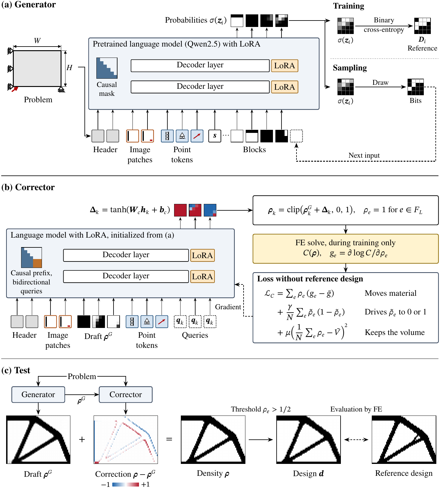

# A pretrained language model with a compliance-trained corrector as a surrogate for structural topology optimization

Deep learning surrogates for topology optimization generate optimized designs without repeated finite-element
analyses. However, even a recent foundation model fails on many unseen problems, mostly by leaving a load without
material or disconnected from the supports. To address this limitation, this paper proposes a generator based on a
pretrained language model and a corrector that modifies its drafts. The generator takes the problem as text, point
and image tokens and generates a draft as blocks of elements, starting at the supports and the loads. The corrector
updates all blocks of the draft in one forward pass and is trained on the compliance and the volume of its output
without reference designs. A load disconnected from the supports raises this compliance, so the corrector learns to
remove such failures without finite-element solves at test time.

On test problems with random domains, supports and loads, the corrected designs failed on 0.2% of them, less than
one hundredth of the failure rate of this foundation model. On problems with combinations of domains and loads
absent from the training data, they failed on 6.5%, less than a fifth of its rate. These results suggest that a
pretrained language model can be the backbone of such a surrogate and that a compliance-trained corrector reduces
its failures even outside the training data.



Overview of the generator, the corrector and the test pipeline.

This repository contains the code for training and testing the generator and the corrector, and their trained
weights.

## Layout

```
lmto/
  config.py        locations (environment variables) and the sixteen training configurations
  data.py          problems, prompts (header, image patches, point tokens) and the order of the blocks
  model.py         the language model with LoRA and the new input and output layers
  train.py         one generator epoch, or the corrector
  sample.py        drafts of the generator
  correct.py       corrections of the drafts
  fe.py            the FE model of OpenTO (pyEDGE): compliance for the corrector loss and for the scores
  evaluate.py      failure rate, median compliance error and volume fraction error
scripts/
  prepare_data.py  OpenTO and OpenTO-NL into the parquet shards that lmto reads
  train.sh         the fifteen generator epochs, the drafts of the training problems and the corrector
  ddp.sh           one training configuration on several GPUs
  test.sh          drafts, corrections and scores on the three test sets
weights/           the generator and the corrector of the paper, each in three parts
figures/           Fig. 1 of the paper
```

## Requirements

Python 3.11 and a CUDA GPU. `requirements.txt` pins the versions this release was run and verified with (PyTorch
2.10, transformers 5.17, peft 0.21). The FE solves use pyEDGE from the code of Optimize Any Topology (OAT), which is
not redistributed here, and CHOLMOD through scikit-sparse:

```bash
conda create -n lmto python=3.11
conda activate lmto
conda install -c conda-forge scikit-sparse=0.4.16 numba=0.67.0
pip install -r requirements.txt
git clone https://github.com/ahnobari/OptimizeAnyTopology
git -C OptimizeAnyTopology checkout dc5e817
```

All commands run from the root of this repository. The locations are environment variables (defaults in
`lmto/config.py`):

```bash
export LMTO_DATA=data                     # OpenTO and OpenTO-NL as downloaded
export LMTO_DERIVED=data/derived          # written by scripts/prepare_data.py
export LMTO_RESULTS=results               # weights, drafts, designs and scores
export LMTO_PYEDGE=OptimizeAnyTopology    # the clone of the OAT repository
export PYTHONPATH=$PWD
```

## Data

The training problems are the labeled and the NITO problems of [OpenTO](https://huggingface.co/datasets/OpenTO/OpenTO)
(700,000 and 194,000). The test sets are the OpenTO test set (5,000 problems), the NITO test set (5,000) and the
test set of [OpenTO-NL](https://huggingface.co/datasets/OpenTO/OpenTO-NL) (1,500). Their parquet files go to
`$LMTO_DATA/OpenTO/data/` and `$LMTO_DATA/OpenTO-NL/data/`:

```bash
hf download OpenTO/OpenTO --repo-type dataset --local-dir $LMTO_DATA/OpenTO \
  --include "data/labeled-*" --include "data/NITO-*" --include "data/test-*" --include "data/NITO_test-*"
hf download OpenTO/OpenTO-NL --repo-type dataset --local-dir $LMTO_DATA/OpenTO-NL --include "data/test-*"
python scripts/prepare_data.py --workers 16
```

`prepare_data.py` writes every problem with its domain, volume fraction, supports and loads (as segments of nodes)
and reference design to shards of 5,000 problems in `$LMTO_DERIVED`.

## Weights

`weights/` holds the generator after fifteen epochs (`generator-e15`) and the corrector trained on its drafts of all
training problems (`corrector`). Each model holds the LoRA adapters and the new layers in float32 (143 MB) and is
split into three parts below the file size limit of GitHub. The base model Qwen/Qwen2.5-0.5B is downloaded from
Hugging Face by transformers. The parts are joined into the files that the code reads:

```bash
mkdir -p results/generator-e15 results/corrector
cat weights/generator-e15.pt.part* > results/generator-e15/weights.pt
cat weights/corrector.pt.part* > results/corrector/weights.pt
sha256sum results/generator-e15/weights.pt results/corrector/weights.pt
```

| file | sha256 |
|---|---|
| results/generator-e15/weights.pt | `5a730213d631a94b003d39e528fb43d799d4a10093183f766a4694e725674010` |
| results/corrector/weights.pt | `5a3bee6184adc87d2034ef4e66682bc4c8342b6fe0997d7338b42800dd3031df` |

## Test

```bash
bash scripts/test.sh
```

For each test set, `lmto.sample` draws four drafts per problem, `lmto.correct` corrects them and `lmto.evaluate`
scores the designs of both. The scores follow the protocol of the OpenTO papers. The compliance error (CE) compares
the compliance of a binary design with that of the reference design, and a design fails when its CE is at least
100 % or its FE solve fails. CE in the table is the median over the designs that do not fail, and |VFE| is the mean
absolute volume fraction error. The first design comes from the first draft, and the best of four is the design of
lowest CE. With the weights above, the commands reproduce these values from the runs of the paper:

| Test set | Model | First design: Fail. (%) | CE (%) | \|VFE\| (%) | Best of four: Fail. (%) | CE (%) |
|---|---|---|---|---|---|---|
| OpenTO | Generator | 4.3 | 0.17 | 3.38 | 2.5 | 0.04 |
| OpenTO | Generator + corrector | 0.2 | 0.48 | 1.11 | 0.1 | 0.39 |
| NITO | Generator | 1.2 | 0.11 | 3.52 | 0.8 | -0.01 |
| NITO | Generator + corrector | 0.6 | 0.54 | 1.37 | 0.4 | 0.43 |
| OpenTO-NL | Generator | 16.5 | -10.38 | 16.43 | 12.2 | -12.58 |
| OpenTO-NL | Generator + corrector | 6.5 | -8.41 | 4.75 | 4.2 | -10.42 |

The reference designs of OpenTO-NL were optimized with a geometrically nonlinear FE model, while the scores use the
linear compliance, so CEs below zero occur.

The drafts depend on the random draws, on the batches (`--bs`, `--tokens` and `--seed` of `lmto.sample`) and on
the GPU. With other batch settings or on another GPU, the values differ slightly from those above.

## Training

```bash
bash scripts/train.sh                   # on one GPU
GPUS="0 1 2" bash scripts/train.sh      # each training on GPUs 0, 1 and 2 together
```

The script trains fifteen generator epochs (`generator-e1` to `generator-e15`), each from the weights of the one
before with a new order of the problems. It then draws one draft of the fifteenth epoch per training problem and
trains the corrector on these drafts. With `GPUS`, `scripts/ddp.sh` starts one process per GPU. Each process computes
its share of every batch and the gradients are summed, so the steps are those of one GPU. Each GPU draws its own
input flips of the generator, so the generator weights also depend on the number of GPUs. The paper trained the
generator from the fifth epoch on two or three GPUs and the corrector on three. The FE solves of the corrector run in
parallel CPU processes, whose number is `workers` in `lmto/config.py`, divided among the GPUs. A generator epoch has
51,077 to 51,165 steps, and the corrector has 59,729 steps. Each process of the corrector loads the drafts of the
training problems (about 23 GB of memory) and keeps those of its share.
`python -m lmto.train --config NAME --n 1000` runs a configuration on the first 1,000 training problems as a quick
test.

## Citation

```bibtex
@article{hwang2026lmto,
  title  = {A pretrained language model with a compliance-trained corrector as a surrogate for structural topology optimization},
  author = {Hwang, Mikyung and Choi, Minseok},
  year   = {2026}
}
```

## License

The code is released under the MIT license (`LICENSE`). Qwen2.5-0.5B is released under the Apache 2.0 license.
For OpenTO, OpenTO-NL and pyEDGE, see their own pages.
