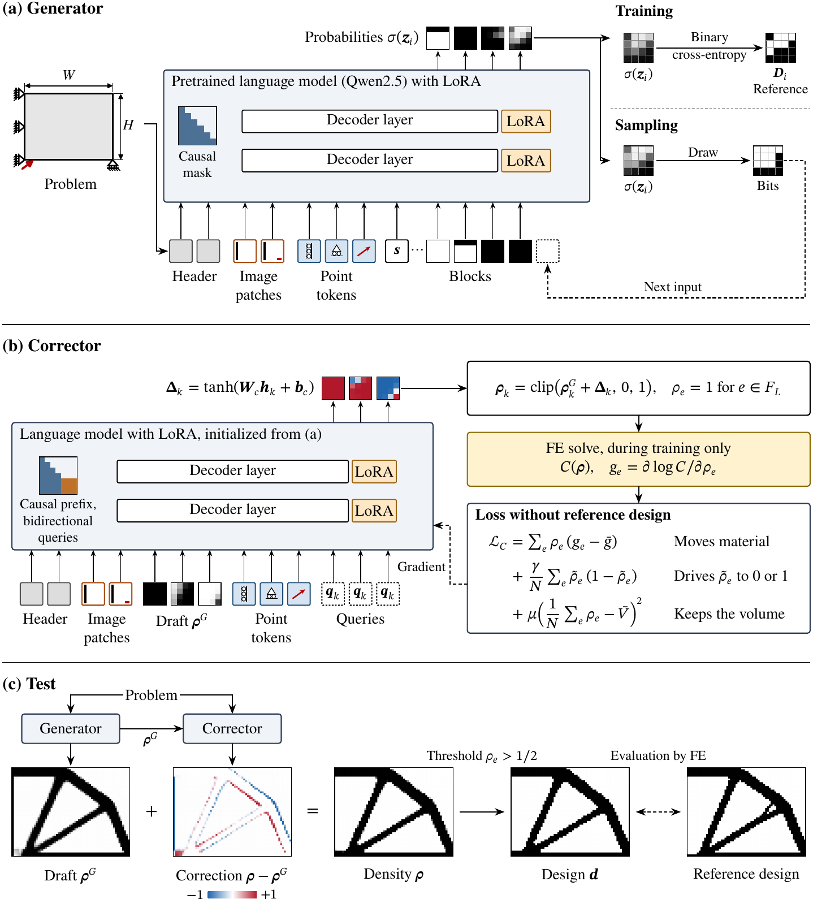

# Structural topology optimization with a pretrained language model and a label-free corrector

Deep generative models trained on optimized designs produce structural topologies for minimum-compliance problems
without iterations, and recent foundation models accept domains of any shape and resolution. However, their designs
can leave a load without material or disconnected from the supports, and repairing them requires finite-element (FE)
solves. To address this limitation, this paper proposes a surrogate whose backbone is a pretrained language model.
Its generator reads the problem as text, point and image tokens and writes a draft as blocks of elements, starting
at the supports and the loads. A corrector that starts from the weights of the generator reads this draft and
corrects all of its blocks in one forward pass. It is trained on the compliance and the volume of its output
without reference designs. A load disconnected from the supports raises this compliance, so the corrector learns
to remove such failures without FE solves at test time.

On random OpenTO problems, the generator failed less often than Optimize Any Topology with material added at the
loads, and the corrector removed most remaining failures. On finite-strain problems, Optimize Any Topology failed
more often than the corrector, but it reached lower compliance errors on a benchmark whose support configurations
occur in the training data. These results suggest that a pretrained language model can serve as the backbone of
such a surrogate and that training on the compliance removes most failures of the generator.



Overview of the generator, the corrector and the test pipeline.

This repository contains the code for training and testing the generator and the corrector, and their trained
weights.

## Layout

```
lmto/
  config.py        locations (environment variables) and the five training configurations
  data.py          problems, prompts (header, image patches, point tokens) and the order of the blocks
  model.py         the language model with LoRA and the new input and output layers
  train.py         one generator epoch, or the corrector
  sample.py        drafts of the generator
  correct.py       corrections of the drafts
  fe.py            the FE model of OpenTO (pyEDGE): compliance for the corrector loss and for the scores
  evaluate.py      failure rate, median compliance error and volume fraction error
scripts/
  prepare_data.py  OpenTO and OpenTO-NL into the parquet shards that lmto reads
  train.sh         the four generator epochs, the drafts of the training problems and the corrector
  test.sh          drafts, corrections and scores on the three test sets
weights/           the generator and the corrector of the paper, each in three parts
figures/           Fig. 1 of the paper
```

## Requirements

Python 3.11 and a CUDA GPU. `requirements.txt` pins the versions this release was run and verified with (PyTorch
2.10, transformers 5.17, peft 0.21). The FE solves use pyEDGE from the code of Optimize Any Topology (OAT), which is
not redistributed here, and CHOLMOD through scikit-sparse:

```bash
conda create -n lmto python=3.11
conda activate lmto
conda install -c conda-forge scikit-sparse=0.4.16 numba=0.67.0
pip install -r requirements.txt
git clone https://github.com/ahnobari/OptimizeAnyTopology
git -C OptimizeAnyTopology checkout dc5e817
```

All commands run from the root of this repository. The locations are environment variables (defaults in
`lmto/config.py`):

```bash
export LMTO_DATA=data                     # OpenTO and OpenTO-NL as downloaded
export LMTO_DERIVED=data/derived          # written by scripts/prepare_data.py
export LMTO_RESULTS=results               # weights, drafts, designs and scores
export LMTO_PYEDGE=OptimizeAnyTopology    # the clone of the OAT repository
export PYTHONPATH=$PWD
```

## Data

The training problems are the labeled and the NITO problems of [OpenTO](https://huggingface.co/datasets/OpenTO/OpenTO)
(700,000 and 194,000). The test sets are the OpenTO test set (5,000 problems), the NITO test set (5,000) and the
test set of [OpenTO-NL](https://huggingface.co/datasets/OpenTO/OpenTO-NL) (1,500). Their parquet files go to
`$LMTO_DATA/OpenTO/data/` and `$LMTO_DATA/OpenTO-NL/data/`:

```bash
hf download OpenTO/OpenTO --repo-type dataset --local-dir $LMTO_DATA/OpenTO \
  --include "data/labeled-*" --include "data/NITO-*" --include "data/test-*" --include "data/NITO_test-*"
hf download OpenTO/OpenTO-NL --repo-type dataset --local-dir $LMTO_DATA/OpenTO-NL --include "data/test-*"
python scripts/prepare_data.py --workers 16
```

`prepare_data.py` writes every problem with its domain, volume fraction, supports and loads (as segments of nodes)
and reference design to shards of 5,000 problems in `$LMTO_DERIVED`.

## Weights

`weights/` holds the generator after four epochs (`generator-e4`) and the corrector trained on its drafts of all
training problems (`corrector`). Each model holds the LoRA adapters and the new layers in float32 (143 MB) and is
split into three parts below the file size limit of GitHub. The base model Qwen/Qwen2.5-0.5B is downloaded from
Hugging Face by transformers. The parts are joined into the files that the code reads:

```bash
mkdir -p results/generator-e4 results/corrector
cat weights/generator-e4.pt.part* > results/generator-e4/weights.pt
cat weights/corrector.pt.part* > results/corrector/weights.pt
sha256sum results/generator-e4/weights.pt results/corrector/weights.pt
```

| file | sha256 |
|---|---|
| results/generator-e4/weights.pt | `03783c1bc1e14e6d89c5aabafedf7053302c64c8f0b685f1f260e49a7b679607` |
| results/corrector/weights.pt | `7ec4c206f621c355c23f2c0df9599321b221e683680a113e55ea50131ff4ac49` |

## Test

```bash
bash scripts/test.sh
```

For each test set, `lmto.sample` draws four drafts per problem, `lmto.correct` corrects them and `lmto.evaluate`
scores the designs of both. The scores follow the protocol of the OpenTO papers. The compliance error (CE) compares
the compliance of a binary design with that of the reference design, and a design fails when its CE is at least
100 % or its FE solve fails. CE in the table is the median over the designs that do not fail, and |VFE| is the mean
absolute volume fraction error. The first design comes from the first draft, and the best of four is the design of
lowest CE. With the weights above, the commands reproduce these values from the runs of the paper:

| Test set | Model | First design: Fail. (%) | CE (%) | \|VFE\| (%) | Best of four: Fail. (%) | CE (%) |
|---|---|---|---|---|---|---|
| OpenTO | Generator | 7.6 | 0.74 | 4.79 | 3.8 | 0.30 |
| OpenTO | Generator + corrector | 0.4 | 1.12 | 1.12 | 0.1 | 0.87 |
| NITO | Generator | 2.4 | 0.15 | 4.44 | 1.3 | -0.01 |
| NITO | Generator + corrector | 1.2 | 1.02 | 1.42 | 0.7 | 0.82 |
| OpenTO-NL | Generator | 21.7 | -6.94 | 19.74 | 13.4 | -11.36 |
| OpenTO-NL | Generator + corrector | 4.7 | -3.06 | 4.31 | 2.5 | -6.31 |

The reference designs of OpenTO-NL minimize the compliance under finite strain, while the scores use the linear
compliance, so CEs below zero occur.

The drafts depend on the random draws, on the batches (`--bs`, `--tokens` and `--seed` of `lmto.sample`) and on
the GPU. With other batch settings or on another GPU, the values differ slightly from those above.

## Training

```bash
bash scripts/train.sh
```

The script trains four generator epochs (`generator-e1` to `generator-e4`), each from the weights of the one before
with a new order of the problems. It then draws one draft of the fourth epoch per training problem and trains the
corrector on these drafts. The FE solves of the corrector run in parallel CPU processes, whose number is `workers`
in `lmto/config.py`. A generator epoch has 51,083 steps, and the corrector has 59,729 steps. The drafts of the
training problems take about 23 GB of memory during the training of the corrector.
`python -m lmto.train --config NAME --n 1000` runs a configuration on the first 1,000 training problems as a quick
test.

## Citation

```bibtex
@article{hwang2026lmto,
  title  = {Structural topology optimization with a pretrained language model and a label-free corrector},
  author = {Hwang, Mikyung and Choi, Minseok},
  year   = {2026}
}
```

## License

The code is released under the MIT license (`LICENSE`). Qwen2.5-0.5B is released under the Apache 2.0 license.
For OpenTO, OpenTO-NL and pyEDGE, see their own pages.
